<!-- ============================== HERO ============================== -->
<div align="center">



<a href="https://github.com/Deepika-i">
  
</a>

<br/>


</div>


<!-- ============================== ABOUT ============================== -->
<h2 align="center">❖ &nbsp;A B O U T &nbsp; M E&nbsp; ❖</h2>

<div align="center">


</div>

<br/>

```js
const deepika = {
  education : "BCA Graduate (2021)",
  location  : "Tamil Nadu, India",
  interests : ["Web Development", "Mobile Development"],
  focus     : "Building practical projects and improving my skills",
  motto     : "Always Learning, Always Building"
};
```


<!-- ============================== SKILLS ============================== -->
<h2 align="center">❖ &nbsp;T E C H &nbsp; S T A C K&nbsp; ❖</h2>

<div align="center">


<br/>


<br/><br/>


</div>


<!-- ============================== PROJECTS ============================== -->
<h2 align="center">❖ &nbsp;F E A T U R E D &nbsp; P R O J E C T S&nbsp; ❖</h2>

<table align="center">
<tr>
<td align="center" width="50%" valign="top">

### 🌹 Personal Portfolio
*My personal developer portfolio, built with React and CSS.*


<br/><br/>

<a href="https://my-portfolio-psi-eight-46.vercel.app/"></a>
<a href="https://github.com/Deepika-i/My-Portfolio"></a>

</td>
<td align="center" width="50%" valign="top">

### 🏡 HomeEase
*A mobile application built with React Native.*


<br/><br/>

<a href="https://homeease-rho.vercel.app/"></a>
<a href="https://github.com/Deepika-i/HomeEase"></a>

</td>
</tr>
</table>


<!-- ============================== ANALYTICS ============================== -->
<h2 align="center">❖ &nbsp;G I T H U B &nbsp; A N A L Y T I C S&nbsp; ❖</h2>

<div align="center">


<br/>


<br/><br/>


<br/><br/>


</div>


<!-- ============================== FOOTER ============================== -->
<div align="center">


</div>

